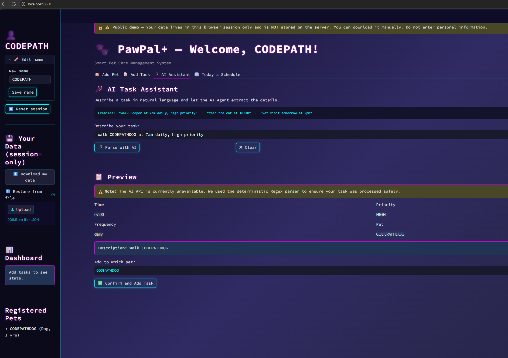
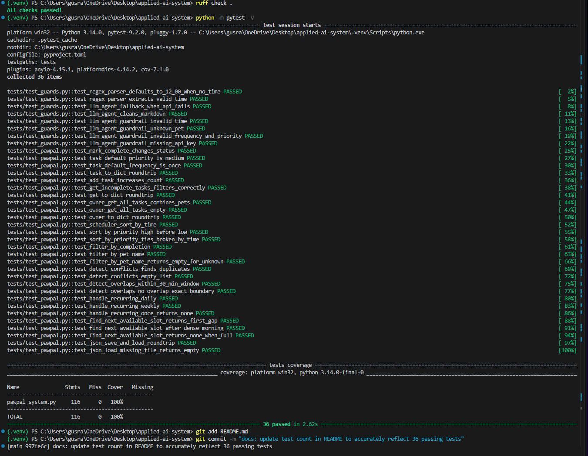

# 🐾 PawPal+ — Applied AI System

<p align="center">
  
</p>

[](https://applied-ai-system-fv58skt8adndvpep3bslq.streamlit.app)
[](https://github.com/codewarrior777/applied-ai-system/actions)
[](https://github.com/codewarrior777/applied-ai-system/actions)
[](https://github.com/codewarrior777/applied-ai-system)
[](https://github.com/codewarrior777/applied-ai-system)
[](https://github.com/codewarrior777/applied-ai-system)

A CLI-first and Web-based Python application for managing pets, their care tasks, and scheduling them intelligently. 

This project is an evolution of **PawPal+ (Module 2)**, upgraded for the **Applied AI System Capstone (Module 4)**. It integrates a true **Agentic AI Workflow** to parse natural language, protected by a robust **Guardrail Architecture** and strict **Observability Tracing**.

**Course:** AI 110 — Foundations of AI Engineering  
**Project:** Capstone (Applied AI System)

---

## 🌐 Try It Live

**[▶ Open the Applied AI System on Streamlit Cloud](https://applied-ai-system-fv58skt8adndvpep3bslq.streamlit.app)**

No installation needed — just click and use it in your browser.

---

## 📌 What It Does

PawPal+ lets a pet owner:

- Register multiple pets under their name.
- Add care tasks to each pet (walks, feeding, meds, vet visits).
- **Parse tasks from natural language using an LLM Agent** (via OpenRouter).
- View a **combined daily schedule** across all pets.
- **Sort** tasks chronologically by time or by priority.
- **Detect scheduling conflicts** and overlapping 30-minute windows.
- **Find the next available slot** in the day for a new task.

---

## 🧠 The Capstone AI Upgrade (Agentic Workflow & Guardrails)

For this Capstone, the original Regex-based parser was upgraded to an **AI Agent**. 

### How It Works
1. **The Agent:** When you type a task (e.g., *"Take Cooper for a walk at 6:30pm daily, it's urgent"*), the app sends it to a free LLM via **OpenRouter**.
2. **The JSON Parser:** The LLM is strictly prompted to return a structured JSON object (description, time, frequency, priority, pet_name).
3. **The Guardrails:** To make this "production-ready", we built three layers of safety:
   - **Markdown Stripping:** Cleans any accidental formatting the LLM adds.
   - **Strict Time Validation:** A Python Regex checks the LLM's output to ensure the time is a valid `HH:MM` format. It rejects hallucinations like "25:00".
   - **Hallucination Mitigation:** Ensures the pet name extracted by the AI actually exists in the user's database before saving. 

### The Ultimate Reliability Test: The Fallback
During development, the free LLM API suffered massive outages (Error 429, 404, 503). Because of our **Guardrail Architecture**, the app never crashed. 

If the API fails, the system logs the error and instantly executes the original **Deterministic Regex Parser** (`nl_parser.py`). **The user never sees an error screen and still gets their task parsed.**

### 🔍 Agent Observability (LLM vs. Fallback)
A critical part of this project is **observability**. The system does not hide its failures. Both the Streamlit UI, the FastAPI response, and the Evaluation Harness track whether a task was parsed by the LLM or the Regex Fallback. This ensures we know exactly when the AI is performing well and when the system is relying on the safety net.

---

## 🤖 Agentic Enhancements (Stretch Goals)

To go beyond the basic requirements, we implemented three advanced AI features:

### 1. Evaluation Harness (Honest Metrics)
We included a custom `evaluate.py` script that runs a dataset of 10 natural language inputs against the AI Agent.

```bash
python evaluate.py
```

It generates a detailed report that separates **Total Accuracy** from **Agent Observability** (showing exactly how many tests were handled by the LLM and how many by the Fallback). It also includes a coverage test for `_get_pet_context` with malformed JSON to ensure the RAG system fails gracefully.

### 2. Agentic Trace (Transparency)
The LLM Agent logs its execution steps at every stage (`Input Analysis -> RAG Retrieval -> LLM Planning -> Deterministic Validation -> Output`). This provides full transparency into the "thought process" of the agent and helps debug why a specific guardrail might have triggered.

### 3. Lightweight RAG (Retrieval-Augmented Generation)
The agent retrieves local context from `pet_knowledge.json` (e.g., pet allergies, diet, notes) and injects it into the system prompt. This allows the AI to make context-aware decisions, such as avoiding scheduling tasks that conflict with a pet's known allergies.

---

## 🏗️ System Architecture

The system has five core modules. We provide two architectural diagrams in the `diagrams/` folder:

- `diagrams/class_diagram.md`: The core OOP structure (Task, Pet, Owner, Scheduler).
- `diagrams/architecture.md`: The AI data flow (Input -> LLM Agent -> Guardrails -> Fallback -> Output).

| Module | Responsibility |
| :--- | :--- |
| **Task / Pet / Owner** | Data classes that represent the domain entities. |
| **Scheduler** | The "brain" — sorts, filters, detects conflicts, finds gaps. |
| **NL Parser** | Deterministic Regex fallback for parsing tasks offline. |
| **AI Agent (`llm_agent.py`)** | Handles OpenRouter API calls, JSON validation, Guardrails, RAG, and Agent Trace. |
| **UI / API** | Streamlit interface and FastAPI REST endpoints. |

---

## 🚀 How to Run

### Prerequisites
- Python 3.12+

### Setup
```bash
# Clone the repository
git clone https://github.com/codewarrior777/applied-ai-system.git
cd applied-ai-system

# Create and activate a virtual environment
python -m venv .venv
.\.venv\Scripts\Activate.ps1   # Windows PowerShell
# source .venv/bin/activate     # macOS / Linux

# Install dependencies (includes openai, python-dotenv, etc.)
pip install -r requirements.txt
```

### Environment Variables
You must provide an OpenRouter API key to enable the AI Agent. Create a `.env` file in the root directory:
```env
OPENROUTER_API_KEY="sk-or-v1-your_api_key_here"
```
*(If no key is provided, the app will safely default to the Regex parser).*

### Run the Streamlit UI
```bash
streamlit run app.py
```

### Run the FastAPI REST API
```bash
uvicorn api:app --reload
# Swagger docs at http://127.0.0.1:8000/docs
```

### Run the tests
```bash
python -m pytest -v
```

### Run the AI Evaluation Harness
```bash
python evaluate.py
```

---

## 📋 Sample Input / Output (Demonstration)

Here are examples of the system handling various inputs end-to-end, using the AI Agent with Guardrails:

### Example 1: Natural Language with Priority
**Input:** `"Take Cooper for a walk at 6:30pm daily, it's urgent"`

**Agent Output:**
```json
{
  "description": "Walk Cooper", 
  "time": "18:30", 
  "frequency": "daily", 
  "priority": "high", 
  "pet_name": "Cooper",
  "source": "llm"
}
```

### Example 2: Missing Time (Defaults used)
**Input:** `"Feed Prince"`

**Agent Output:**
```json
{
  "description": "Feed Prince", 
  "time": "12:00", 
  "frequency": "once", 
  "priority": "medium", 
  "pet_name": "Prince",
  "source": "llm"
}
```

### Example 3: The Guardrail / Fallback in Action
**Input:** `"Give the dog a bath"` *(Simulating an API outage)*

**Agent Output:** Because the external LLM API was down, the system caught the error and used the Regex fallback to successfully output the data without crashing the app:
```json
{
  "description": "Give the dog a bath", 
  "time": "12:00", 
  "frequency": "once", 
  "priority": "medium", 
  "pet_name": null,
  "source": "fallback"
}
```

---

## 🌐 REST API (FastAPI)

PawPal+ exposes a REST API with auto-generated Swagger documentation.
The `/api/parse-task` endpoint uses the exact same Agentic AI Workflow and Guardrails as the UI. The response includes a `source` field to indicate whether the LLM or the Fallback processed the request.

```bash
# Parse natural language via API
curl -X POST http://127.0.0.1:8000/api/parse-task \
  -H "Content-Type: application/json" \
  -d '{"text": "walk Cooper at 7am daily, high priority", "known_pets": ["Cooper"]}'
```

---

## 🔒 Security & Responsible AI

- **No API Keys in Code:** The OpenRouter API key is loaded securely via `.env` (and ignored in `.gitignore`).
- **Session-Only Data:** User pet data is never stored on the server; it lives in the browser session (`st.session_state`) and can be downloaded as JSON. This was a deliberate architectural decision (ADR-007) to prevent cross-user data leakage.
- **Hallucination Mitigation:** The LLM cannot invent new pets or schedule impossible times. Our Guardrails strictly validate the pet name against the user's database and enforce a valid `HH:MM` time regex.
- **Graceful Degradation:** The RAG context retrieval (`_get_pet_context`) is wrapped in error handling. If `pet_knowledge.json` is missing or corrupted, the agent logs the error and continues with an empty context rather than crashing the application.

---

## 🧪 Test Results & CI

- **Test Suite:** 36 passing tests with 100% coverage on the core domain logic (`pawpal_system.py`).
- **CI Pipeline:** Continuous Integration via GitHub Actions runs `pytest` and `ruff check` on every push to ensure the AI integration didn't break the core logic.

<p align="center">
  
</p>

---

## 📁 Project Structure

```text
applied-ai-system/
├── assets/                    # Screenshots and UI images
│   ├── applied_AI_system_hud.png
│   └── test_passed.png
├── diagrams/
│   ├── class_diagram.md       # OOP Class structure (Mermaid)
│   └── architecture.md        # AI Workflow data flow (Mermaid)
├── .github/workflows/         # CI: pytest + ruff
├── .streamlit/                # Cyberpunk theme configuration
│   └── config.toml
├── tests/                     # 36 passing tests
├── app.py                     # Streamlit UI (uses LLM Agent)
├── api.py                     # FastAPI endpoints (uses LLM Agent)
├── evaluate.py                # Evaluation Harness (Stretch Goal)
├── llm_agent.py               # THE AI AGENT (OpenRouter + Guardrails + RAG + Trace)
├── nl_parser.py               # Regex fallback parser
├── pawpal_system.py           # Core domain logic
├── pet_knowledge.json         # Local knowledge base for RAG
├── model_card.md              # AI Collaboration & Reliability Reflection
└── requirements.txt
```

---

## 🙏 Credits

Built by **Gustavo Ramos** for the Applied AI System Capstone.

| Role | Details |
| :--- | :--- |
| **Architecture** | AI Agent + Fallback · 2 Mermaid diagrams |
| **Quality** | 36 tests · 100% core coverage · CI Green |
| **AI Stack** | OpenRouter (LLM) · Python Regex (Guardrail) · RAG |
| **Standards** | PEP 8 · Conventional Commits |

<br>

<p align="center" style="color: #ffffff; font-weight: 900; font-size: 34px; line-height: 1.5; max-width: 900px; margin: 0 auto; text-shadow: 1px 1px 0 #fff, -1px -1px 0 #fff, 1px -1px 0 #fff, -1px 1px 0 #fff, 0 0 20px rgba(255,255,255,0.5);">
  "The true test of an AI system is not how it performs when the API works, but how it behaves when the API fails."
</p>

<br>
```

